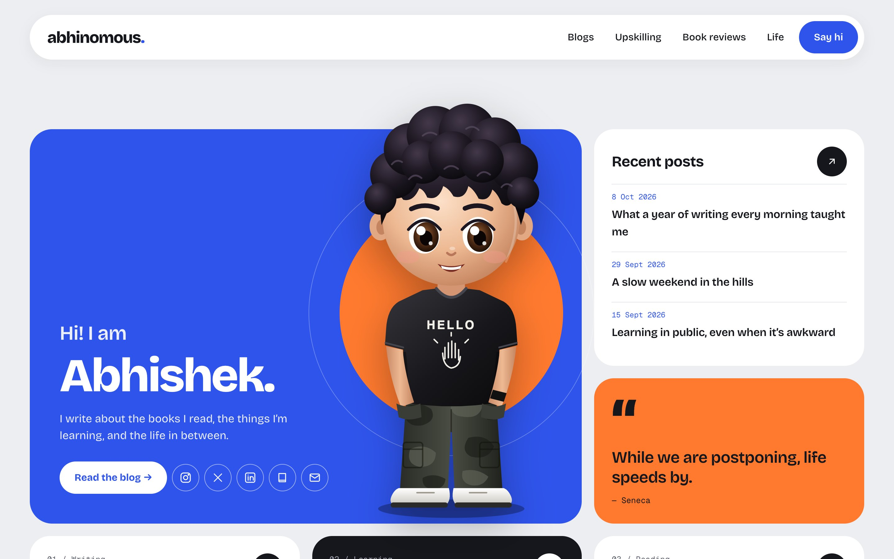
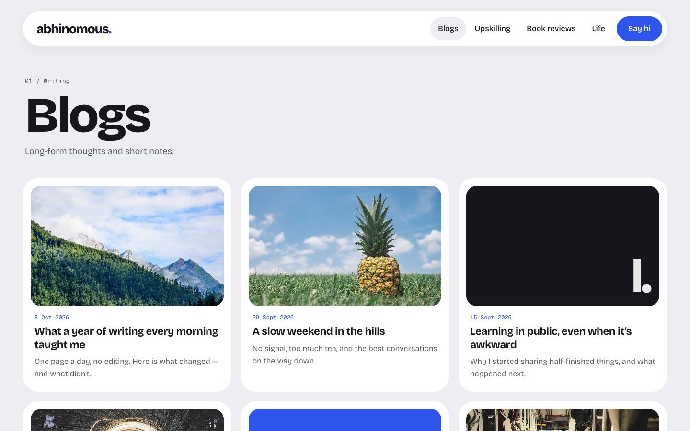
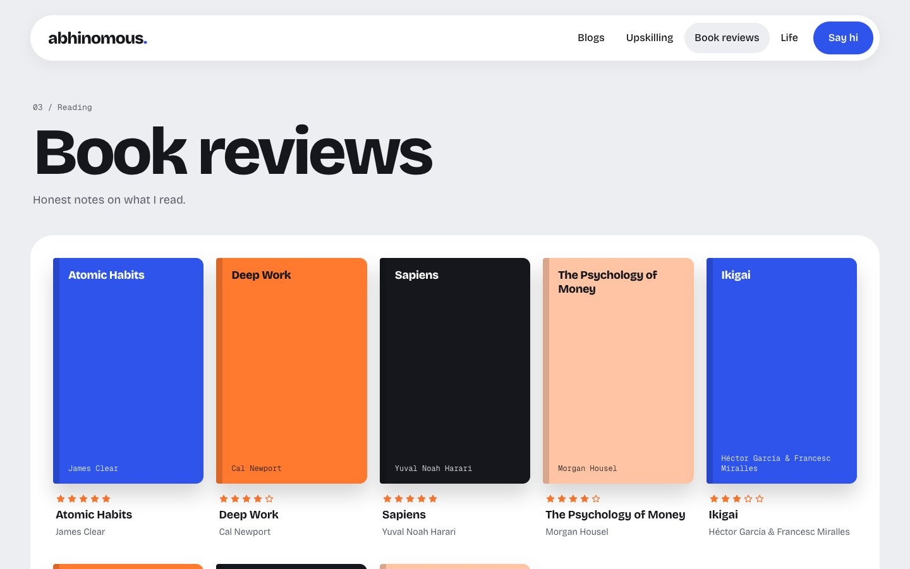
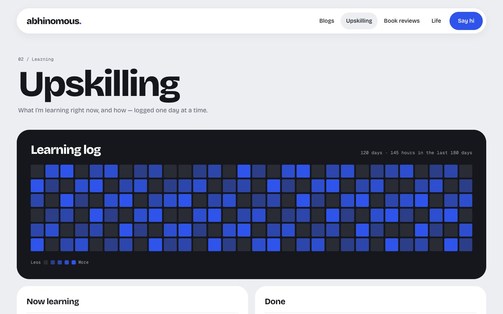
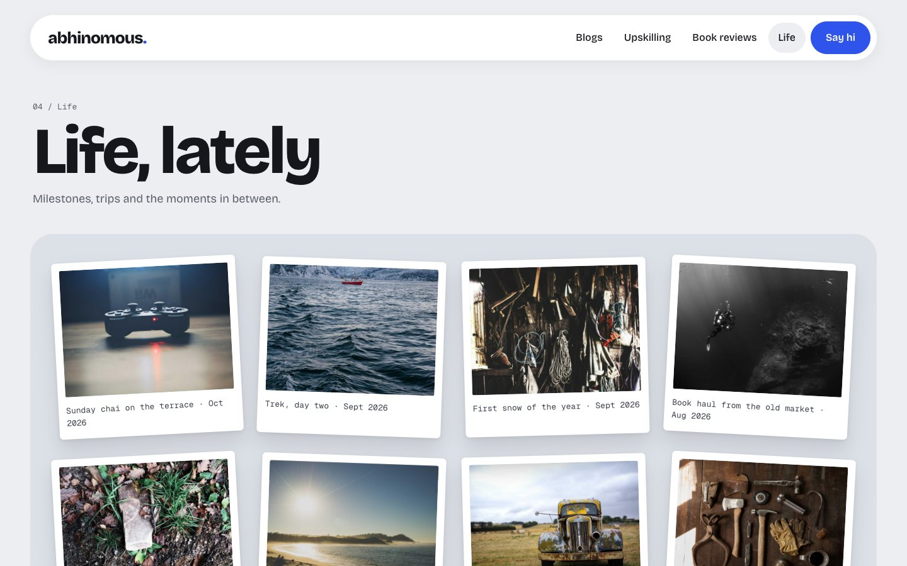
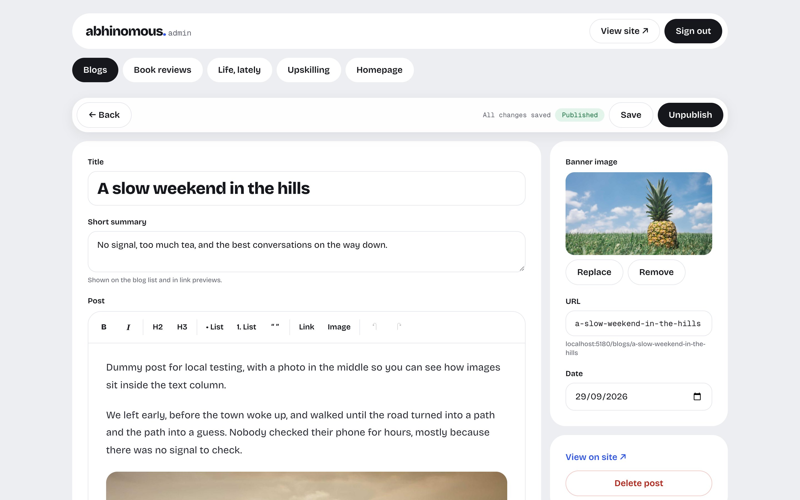
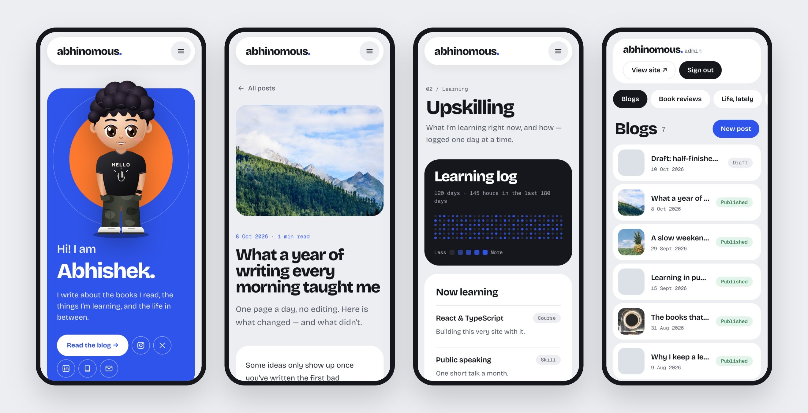
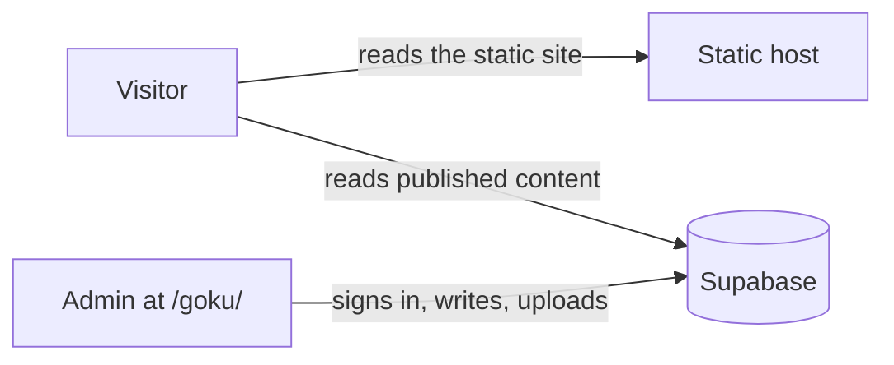

<div align="center">

# abhinomous<span>.</span>

**A personal site for blogs, book reviews, learning logs and life photos, with a private admin to write it all.**

[**abhinomous.com**](https://abhinomous.com) · [Quick start](#quick-start) · [Make it yours](#make-it-yours) · [Deploy](#deploy)

[](https://github.com/SuTechs/abhinomous/actions/workflows/ci.yml)



</div>

Abhinomous is the personal site of Abhishek Kumar, built as a template anyone can reuse. It's a fast static site with a bento-style design. Content lives in [Supabase](https://supabase.com), and the owner writes it from a hidden admin page. There's no server to run: build once, upload anywhere.

## What's inside

- **Homepage:** a big avatar that tilts with the mouse, recent posts, a quote of the week, and tiles for every section.
- **Blogs:** a 3-column grid of posts, plus post pages with a banner image and comfortable reading typography.
- **Book reviews:** a bookshelf of covers with star ratings. Books without a cover get a generated one.
- **Upskilling:** a GitHub-style learning log (one square per day) and lists of what's in progress and what's done.
- **Life, lately:** a polaroid photo log.
- **Admin at `/goku/`:** email + password login (no sign-ups), a rich-text editor with image uploads, drafts, bulk photo upload from a phone, and homepage settings (intro, quote, social links, avatar).
- **Works on phones:** every page and the admin are responsive.
- **Local test mode:** `npm run dev` runs the whole site and admin on dummy data in your browser. No Supabase account is needed to try it.

<table>
  <tr>
    <td></td>
    <td></td>
    <td></td>
  </tr>
  <tr>
    <td align="center">Blogs</td>
    <td align="center">Post</td>
    <td align="center">Book reviews</td>
  </tr>
  <tr>
    <td></td>
    <td></td>
    <td></td>
  </tr>
  <tr>
    <td align="center">Upskilling</td>
    <td align="center">Life, lately</td>
    <td align="center">Admin editor</td>
  </tr>
</table>



## Quick start

You need [Node.js](https://nodejs.org) 20.19 or newer.

```bash
git clone https://github.com/SuTechs/abhinomous.git
cd abhinomous
npm install
npm run dev
```

Open http://localhost:5173 for the site and http://localhost:5173/goku/ for the admin. Click **Sign in as test admin** to log in.

This is **local test mode**, which works like this:

- The site runs on a small in-browser stand-in for Supabase ([`src/lib/mock/`](src/lib/mock)), filled with [dummy content](src/lib/mock/seed.ts).
- Anything you add, edit, upload or delete is saved in that browser only. **Reset test data** in the admin header restores the dummy data.
- It follows the same rules as the real database: visitors never see drafts, and only a signed-in admin can make changes.
- The dummy photos load from picsum.photos, so they need an internet connection.

## Make it yours

| What | Where |
| --- | --- |
| Name, site title, wordmark, description | [`src/site.config.ts`](src/site.config.ts) |
| Intro line, quote, social links, email, avatar | Admin → **Homepage** (stored in Supabase) |
| Colours and fonts | `@theme` in [`src/styles.css`](src/styles.css) |
| Placeholder avatar | [`public/avatar.svg`](public/avatar.svg), used until you upload one in the admin |
| Admin address (`/goku/`) | Rename the `goku/` folder and its entry in [`vite.config.ts`](vite.config.ts) |
| Dummy content for local test mode | [`src/lib/mock/seed.ts`](src/lib/mock/seed.ts) |

## Set up Supabase

1. Create a free project at [supabase.com](https://supabase.com).
2. **SQL Editor → New query:** paste [`supabase/schema.sql`](supabase/schema.sql) and click **Run**. This creates the tables, the access rules and a `media` bucket for images. It's safe to run again after updates.
3. **Authentication → Sign In / Providers:** turn **off** "Allow new users to sign up".
4. **Authentication → Users → Add user → Create new user:** enter the admin's email and password, and tick **Auto Confirm User**.
5. **SQL Editor:** make that user an admin:
   ```sql
   insert into public.admins (user_id) select id from auth.users where email = 'you@example.com';
   ```
6. **Project Settings → API Keys:** copy the project URL and the **publishable** key into `.env`:
   ```bash
   cp .env.example .env
   ```
7. Run against the real database:
   ```bash
   npm run prod
   ```

> [!IMPORTANT]
> Use only the **publishable** key. It's built into the site's JavaScript, so anyone can see it, and Supabase designed it for exactly that: the database rules decide what it can do. **Never** use the secret / `service_role` key anywhere in this project.

## Deploy

`npm run build` creates a static site in `dist/`. It always uses the real Supabase from `.env`, and refuses to build without it.

### Hostinger, with auto-deploy (how abhinomous.com runs)

Hostinger builds the site from GitHub and redeploys it on every push to `main`.

1. hPanel → **Websites → Create website → Web App → Connect with GitHub.** Give Hostinger access to this repository only.
2. Pick the repository and the `main` branch. Build settings: framework **Vite**, build command `npm run build`, output directory `dist`, Node **22 or newer**.
3. **Environment variables:** add `VITE_SUPABASE_URL` and `VITE_SUPABASE_PUBLISHABLE_KEY`.
4. Deploy, then connect your domain.

The two values are used when the site is built: if you change one in Hostinger, redeploy.

### Any other static host

Upload the contents of `dist/`. Links that open a page directly, like `/blogs/my-post`, need the host to serve `index.html` for unknown paths, and `dist/` ships the config for the common hosts:

- `.htaccess` for Apache, Hostinger and cPanel
- `_redirects` for Netlify and Cloudflare Pages
- `404.html` for GitHub Pages and similar

## Releasing

```bash
npm run release             # 0.1.0 → 0.1.1
npm run release -- minor    # 0.1.0 → 0.2.0
```

The script checks the site builds, bumps the version, tags it, and pushes `main`, which your host redeploys. It also creates a [GitHub Release](https://github.com/SuTechs/abhinomous/releases) with notes. It needs the [GitHub CLI](https://cli.github.com) and a clean working tree on `main`.

## Scripts

| Command | What it does |
| --- | --- |
| `npm run dev` | Local test mode: dummy data, test admin, no Supabase needed |
| `npm run prod` | Dev server against the real Supabase in `.env` |
| `npm run build` | Production build into `dist/` (needs `.env`) |
| `npm run preview` | Serves the production build locally |
| `npm run typecheck` | TypeScript check |
| `npm run release` | Version, tag, push and GitHub Release |

## How it works



- The site is a static React app. It talks to Supabase from the browser using the publishable key.
- **Row Level Security** does the guarding:
  - Anyone can read published posts, reviews and photos, the skills list, the learning log and the homepage settings.
  - Only users listed in `public.admins` can read drafts, write anything or upload images. The check runs in a private database function the API doesn't expose.
  - Sign-ups are off, so nobody else can get an account.
- The `/goku/` admin is not linked anywhere, has `noindex`, and isn't listed in `robots.txt`. That's only a courtesy, though; the database rules are the real protection.
- The admin is a separate page, so visitors never download the editor.

## Project layout

```
index.html              public site entry
goku/index.html         admin entry (noindex)
src/site.config.ts      your name, title and description
src/site/               public site: tiny router, components, pages
src/admin/              admin: login, editors (Tiptap), image upload
src/lib/                Supabase client, types, queries
src/lib/mock/           local test mode: in-browser stand-in + dummy data
supabase/schema.sql     tables, access rules, storage bucket
public/                 avatar, favicon, robots.txt, host redirect files
scripts/                build helpers and the release script
.github/workflows/      CI and keep-Supabase-awake
```

**Built with:** [React 19](https://react.dev) · [Vite](https://vite.dev) · [Tailwind CSS 4](https://tailwindcss.com) · [Supabase](https://supabase.com) · [Tiptap](https://tiptap.dev) · [Bricolage Grotesque](https://fonts.google.com/specimen/Bricolage+Grotesque) & [Geist Mono](https://fonts.google.com/specimen/Geist+Mono)

## Keeping Supabase awake

Free Supabase projects pause after a stretch with no activity. The [keep-awake workflow](.github/workflows/keep-supabase-awake.yml) pings the database twice a week. To switch it on, add two repository secrets under Settings → Secrets and variables → Actions: `VITE_SUPABASE_URL` and `VITE_SUPABASE_PUBLISHABLE_KEY`.

## License

[MIT](LICENSE). Use it for your own site: fork it, change [`src/site.config.ts`](src/site.config.ts), and make it yours. A link back is appreciated but not required.
